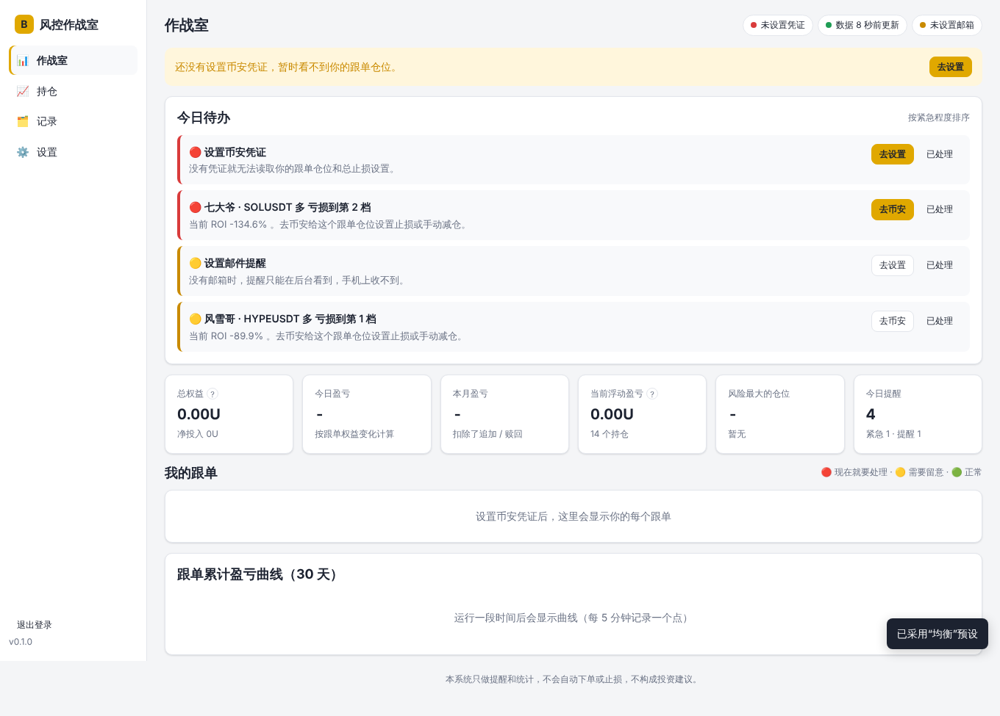

# bian — 币安合约跟单风控作战室

目标：跟单币安领航员时，**领航员亏损时少亏，盈利时尽量跟上**。

一个装在你自己服务器上的网页后台：看清每个跟单、每个仓位的风险，告诉你“现在该做什么”，亏损到档位或凭证失效时发邮件提醒你。

**只读、不下单**：所有操作都由你在币安 App 或网页上完成，后台里的每条建议都附带入口链接。



## 能做什么

| 页面 | 内容 |
|---|---|
| **作战室** | 状态条（凭证 / 数据新鲜度 / 邮件），**今日待办**（按紧急程度排序，可标记“已处理”），总权益、今日/本月盈亏、浮动盈亏、风险最大的仓位，每个跟单的卡片（权益、回撤、是否设置总止损、红黄绿灯），累计盈亏曲线 |
| **持仓** | 我的跟单仓位：保证金、浮动盈亏、ROI、所处亏损档位、**持仓过程最深浮亏 / 最高浮盈**、持仓时长；多空对冲合并显示并列出两条腿 |
| **统计** | 盈亏日历（按天的已实现净盈亏 / 权益变化两种口径）、今日 / 昨日 / 本周 / 本月 / 近 30 天 / 全部汇总、盈亏构成（已实现、手续费、分润）、最大的 10 笔亏损和单笔盈亏分布、止损 / 提前离场效果、按领航员的利润回吐 |
| **领航员** | 排行（我的盈亏、胜率、盈亏比、回撤、提前离场净效果、扛单率、回吐率、提醒次数，点列头排序）；详情页：风格画像（标签 + 指标）、每笔仓位“最深浮亏 vs 最高浮盈”散点图、止损 / 保本 / 回撤止盈回测（含样本外检验）、**止损档位 / 总止损 / 分批止盈推荐（一键采用）**、我在他身上的离场记录和历史仓位、导出 / 删除数据。**发现领航员**：按收益、回撤、跟单者盈亏、规模筛选币安榜单，一键加入观察并自动分析 |
| **记录** | 提醒记录（每条是否送达、失败原因）、事件日志（仓位变化、提醒、凭证、设置修改、数据中断…，可筛选搜索）、仓位回合（每个仓位从开到平的全过程，自动标注“利润回吐 / 盈转亏 / 是否分批止盈”，点进去看 **ROI 走势时间线**）、**离场判定**；事件日志可导出 CSV / JSON |
| **设置** | 币安凭证（**直接粘贴浏览器的 Copy as cURL**，先验证再保存）、邮件（163 预设、**哪些事件发邮件**、汇总间隔、测试邮件）、风控参数（保守 / 均衡 / 激进三套预设 + 高级参数 + 按领航员单独设置）、每日摘要邮件和自动备份的时间、修改密码 |

提醒规则（都可以在网页上调整）：

- **仓位亏损分档**：默认 -50% / -100% / -150%，也可以按“价格波动 × 杠杆”设置，或在领航员页采用推荐的档位。每档每个仓位只提醒一次（回升后又跌回，当天也不重复）；跌到更高一档立即再提醒；同一仓位至少间隔 15 分钟，每天最多 4 条；金额小于 2U 不提醒；加仓不会重置档位，但**亏损超过第 1 档还在加仓**（摊平扛单）会单独提醒。
- **跟单账户**：权益从最高点回撤 10% / 20%；没设置币安“跟单总止损”时每天提醒一次，并给出建议金额；快触发总止损时紧急提醒。
- **盈利保护**：浮盈达到门槛时建议保本；从最高浮盈回落时建议部分止盈；盈利单跌回保本线以下时紧急提醒。
- **凭证失效**：每 10 分钟验证一次，连续 2 次失败才判定为失效，然后**立即发紧急邮件**（不受邮件级别和每小时上限限制），之后每 6 小时提醒一次，直到你更新；更新后发“已恢复”邮件。失效期间暂停私有接口请求，避免触发币安风控。
- **同一事件当天只发一次**：权益回撤、接近强平、接近总止损、组合浮亏超预算这类持续状态，当天只提醒一次（第二天仍在会再提醒一次）；只有明显恶化才当天再发：回撤再加深 5 个点、从提醒线进入紧急线、距强平 / 总止损的距离缩小一半、组合浮亏再扩大 25%。
- **邮件**：只发勾选的事件。默认发：亏损到档位、权益回撤、接近强平、盈利单跌回保本以下、接近总止损、组合浮亏超预算、残留仓位、亏损中加仓、无法监控；默认只记录不发：普通加仓、浮盈回撤、建议保本、分批止盈到位、开仓 / 减仓等信息（每日摘要里会汇总条数）。紧急的立即发，其余**每 60 分钟汇总成一封**；每小时最多 6 封；发送失败 5 分钟后重试；服务重启不会丢掉还在排队的提醒。

## 安装（Ubuntu 22.04 / 24.04，可以和 joz 等项目共存）

```bash
curl -fsSL https://raw.githubusercontent.com/linlea666/bian/main/install.sh -o /tmp/bian-install.sh
```

```bash
sudo bash /tmp/bian-install.sh
```

脚本会：检查系统、端口和磁盘 → 克隆到 `/opt/bian` → 创建独立系统用户 `bian` → 安装并启动 systemd 服务 → 健康检查 → **打印后台地址和初始密码**。

然后：

1. 在云服务器安全组里放行 **TCP 3100**，建议只允许你自己的 IP 访问；
2. 浏览器打开 `http://服务器IP:3100`，用初始密码登录，按引导完成：修改密码 → 粘贴币安凭证 → 设置邮箱并发测试邮件 → 选择风控预设。

资源占用：单个 Python 进程，内存几十 MB；每 20 秒约 7 个请求，每个几 KB。不依赖 Docker，也不使用第三方 Python 包。与 joz 的端口（3000/8080）不冲突，joz 重新构建时也不会影响这里。

### 提前离场自动识别（不用手动标记）

你在币安里手动平仓、止损单 / 止盈单触发、跟单总止损触发，只要**你的仓位平了而领航员还没平**，系统都会自动识别为“提前离场”（部分减仓同样处理）；领航员平仓时你跟着平，算“跟随平仓”。判断依据是你的逐笔成交和领航员的已平仓历史（隐藏持仓的领航员也能拿到）。

等领航员最终平仓后，系统按“如果我没离场、跟到最后”的结果做对比，给出结论：

| 你离场时 | 领航员最后比你差 | 领航员最后比你好 |
|---|---|---|
| 亏损 | **止损挽回** X U | **白止损**（多亏了）X U |
| 盈利 | **避免回吐** X U | **少赚** X U |

- “疑似强平”“疑似总止损”“响应了提醒”只作为备注显示；判断错了可以在离场记录里手动改。
- 领航员平了而你的仓位还在（漏平），会发“残留仓位”提醒。
- **领航员还整仓拿着时**（他的已平仓历史里还没有这一单）：你离场后他的历史又成功同步过一次仍查不到，就判定为“提前离场 · 等领航员平仓”，等他平仓后自动结算。
- **实时监控没看到的平仓也会补上**：凭证失效期间、服务停机期间、20 秒内开平的仓位，以及第二期上线前的平仓，都会从你的历史仓位里补出离场记录（备注“历史回补”，近 30 天）。只在同步到新的历史仓位时比对一次，只查本地数据库，不额外请求币安。
- 这些结果汇总到统计页和领航员排行的“提前离场净效果”，作为你设置止损比例的依据。

### 数据口径

- **已实现净盈亏** = 已实现盈亏 + 手续费，来自你的逐笔成交。更新后首次运行会回补跟单开始以来的历史，日历从第一天就有数据。
- **权益变化** =（权益 − 净投入）的变化，扣除追加和赎回，含浮动盈亏；安装之后才开始有数据。
- **分润**按跟单关系里的累计分润做差。资金费接口没有数据，不计入。
- 日期按服务器时区划分（默认 Asia/Shanghai）。

### 后台任务

- 我的成交和历史仓位每 30 分钟同步一次（有离场在等结算时改为 5 分钟），每天做一次全量核对；凭证失效期间自动暂停。
- 领航员已平仓历史：每天同步一次；有离场在等结算的领航员每 10 分钟一次。
- 新领航员第一次出现时自动排队分析：抓取全部历史，再逐笔拉 K 线计算最深浮亏 / 最高浮盈。K 线请求做了限速（约 2 秒一个），一个领航员通常需要几分钟到几十分钟，页面显示进度，重启后接着跑。
- 每天 08:30 发送摘要邮件：昨日盈亏、各领航员表现、风险最高的仓位、待办、凭证状态。每天 04:00 自动备份，保留 7 份。两个时间都可以在“设置 → 账号与系统”里修改或关闭。

## 日常运维

```bash
cd /opt/bian
```

| 命令 | 作用 |
|---|---|
| `./start.sh status` | 服务状态和健康检查 |
| `./start.sh logs` | 实时查看运行日志 |
| `./start.sh update` | 拉取最新代码并重启：只做快进合并，发现本地有改动就停止；几秒钟完成，数据和设置都保留 |
| `./start.sh restart` / `stop` / `start` | 重启 / 停止 / 启动 |
| `./start.sh doctor` | 自检：币安接口可达性、凭证、邮件、配置、数据库 |
| `./start.sh password` | 忘记密码时，重置为新的随机密码 |
| `./start.sh backup` | 立即备份数据库和设置，保留最近 7 份 |

文件位置：

- 代码：`/opt/bian`；
- 数据库、设置、备份：`/opt/bian/data`；
- 启动参数（端口等）：`/opt/bian/data/config.toml`。

凭证和邮箱授权码保存在 `/opt/bian/data/secrets.json`（权限 600），网页上只显示打码后的内容。

## 凭证失效时怎么办

你会收到一封“币安凭证已失效”的邮件。电脑浏览器登录 binance.com → 按 F12 → Network → 刷新页面 → 过滤框输入 `bapi` → 右键任意一个请求 → **Copy → Copy as cURL** → 打开后台“设置 → 币安凭证”，整段粘贴后点“验证并保存”。如果复制的请求状态显示 “from service worker”，里面不带 Cookie，换一个请求再复制即可。

## 命令行工具（可选）

安装后可以直接使用 `bian` 命令（以 bian 用户运行，读取同一份数据）：

| 命令 | 作用 |
|---|---|
| `bian backtest <领航员ID>` | 领航员画像 + 止损 / 保本 / 回撤止盈规则回测（含样本外验证） |
| `bian copies --diff` | 跟单偏差：超配、低配、漏单、残留，以及我和领航员的实际杠杆对比 |
| `bian costs` | 跟单损耗：手续费、分润、相对领航员的滑点 |
| `bian leaders` | 币安领航员榜单 |

`<领航员ID>` 是领航员主页 URL 中 `lead-details/` 后面的数字。

## 止损 / 止盈推荐（领航员详情页）

推荐只是参考，点“采用”才写入**这个领航员的单独设置**（设置 → 风控参数 → 按领航员单独设置里可以改或恢复全局），绝不自动生效；样本少于 30 笔只展示数据、不给推荐。

- **一句话结论**：卡片开头直接告诉你这个领航员怎么设，例如“不设单仓硬止损 + 用亏损提醒 + 盈利保护 + 跟单总止损兜底”。
- **亏损提醒档位（只提醒，不平仓）**：取他历史上**最后赚钱**的单子在持仓过程中最深浮亏的 75% / 90% / 97% 分位（向上取整到 10%）。页面列出每一档“有多少盈利单 / 亏损单曾跌到这里”；到最深一档建议先减半。
- **盈利保护**：回测全组合里用前 70% 历史选出的“浮盈到位保本 / 回落止盈”方案，只有在后 30% 和全部历史上都比原始跟单好、且不带单仓硬止损时才推荐，采用后浮盈到位时提醒你在币安手动挪止损 / 止盈。
- **跟单总止损比例**：他近 90 天最大回撤 × 1.2（10%–50%）。正常波动不触发，真失控时由币安自动兜底；需要你在币安自己设置。
- **硬止损参考**：回测里“只设止损”最好的一档，以及会误杀多少笔盈利单；不如不设时会明确写出来。
- **你的实盘**：在他身上提前离场 ≥5 次时，说明“白止损多还是挽回多”。
- **分批止盈阶梯**：按他盈利单通常能涨到的浮盈（中位数 / 75% 分位）生成方案，和“不止盈”对比；只有用前 70% 历史选出、在后 30% 也更好的才推荐。采用后浮盈到位时提醒你在币安手动止盈（默认不发邮件）。
- 新版本上线后，旧的分析结果会在后台自动重新分析一次（K 线有缓存，很快）。

## 停止跟单之后

你在币安停止跟单某个领航员后，系统自动把他标为“已停止跟单”（服务停机期间停止的也能识别）。为防止币安接口偶尔返回不全或空列表造成误判，要**连续 3 次读取（至少 2 分钟）都不在跟单列表里**才确认，整个列表突然变空时要持续 10 分钟；期间如果还能查到他的跟单仓位，就不算停止。确认后停止监控和每天同步他的历史（还有离场在等结算时继续同步到结算完）。他的数据**默认一直保留**，统计页照常包含他。在他的详情页可以：

- **转为观察并分析**：继续分析他的风格，方便以后决定要不要再跟；
- **导出数据**：下载 zip，每类数据一个 CSV（Excel 直接打开）外加完整 JSON；
- **删除数据**：输入领航员名字确认后，删除他的全部数据（成交、历史仓位、离场判定、仓位回合、提醒、画像和单独设置）。**删除前会自动备份到服务器 `data/backups`**。正在跟单的领航员不能删除。

## 规划

- 实盘分批止盈的效果统计（执行了止盈 vs 如果没止盈）。

## 精度与限制

- 风控数据来自币安网页接口（需要你的登录凭证），轮询约 20 秒一次，**不是交易所端的止损**。真正的硬止损请在币安里设置，尤其是跟单总止损。
- 全仓 + 双向持仓下，币安返回的强平价经常无效，系统只在强平价位于合理范围时才使用。
- 回测基于公开的已平仓历史 + K 线近似重建：没有逐笔加减仓数据，只计手续费和止损滑点，不计分润和资金费。
- 后台使用 HTTP 访问，提交凭证时有被网络中间人截获的风险。请在安全组里限制只有自己的 IP 能访问；需要更高安全性时，可以把 `[web] host` 改成 `127.0.0.1`，通过 SSH 隧道访问。

更多内容：[接口实测结论](docs/api-findings.md) · [PRD 评审](docs/prd-review.md) · [回测报告示例](docs/examples/backtest-leader-a.md)

---

本系统只做提醒和统计，不会自动下单或止损，不构成投资建议。
